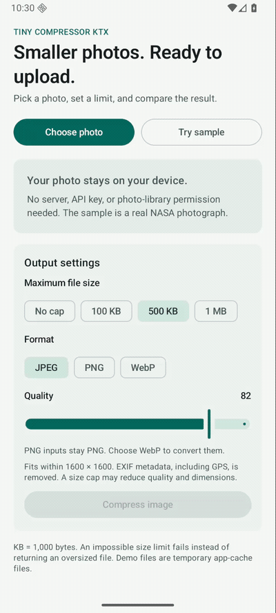

# Tiny Compressor KTX

Prepare Android images for upload with Kotlin coroutines. Set a file-size limit, omit source EXIF, and get the output file with its actual dimensions, format, and size. Supports **Android 9+ (API 28)**, JPEG, PNG, and WebP.

[](https://central.sonatype.com/artifact/io.github.joelromanpr/tiny-compressor-ktx)
[](https://github.com/joelromanpr/tiny-compressor-ktx/actions/workflows/build_test_publish.yml)
[](LICENSE)

```kotlin
val result = ImageCompressor.compressWithResult(
    context,
    Source.Uri(pickedImage),
    Options.forUpload(maxBytes = 500_000),
)
// Pass result.file and result.mimeType to your upload client.
```

A successful call fits the complete output within 500,000 bytes. If the target cannot be met, it throws `IOException`.



Recorded from the real demo on an emulator. Sample photograph: NASA/Apollo 17 crew ([source and usage](benchmark/SOURCES.md)). Times shown belong to that emulator.

## Install

Add `google()` and `mavenCentral()` to your dependency repositories, then:

```kotlin
// app/build.gradle.kts
dependencies {
    implementation("io.github.joelromanpr:tiny-compressor-ktx:1.2.0")
}
```

[Release notes](https://github.com/joelromanpr/tiny-compressor-ktx/releases/tag/v1.2.0) · [Try the demo APK](https://github.com/joelromanpr/tiny-compressor-ktx/releases/download/v1.2.0/tiny-compressor-demo.apk) · [Publication checks](artifacts/releases/1.2.0/verification.json)

## Prepare an image

Call suspending APIs from a coroutine. Inputs can be `Source.File`, `Source.Uri`, or `Source.Bytes`.

```kotlin
import android.content.Context
import android.net.Uri
import com.joelromanpr.tinycompressor.CompressionResult
import com.joelromanpr.tinycompressor.ImageCompressor
import com.joelromanpr.tinycompressor.Options
import com.joelromanpr.tinycompressor.Source

suspend fun prepareUpload(context: Context, image: Uri): CompressionResult =
    ImageCompressor.compressWithResult(
        context,
        Source.Uri(image),
        Options.forUpload(maxBytes = 500_000),
    )
```

`CompressionResult` reports `file`, `outputBytes`, `width`, `height`, `format`, `mimeType`, and `appliedQuality`. `inputBytes` can be null when a URI provider does not report its size. `savingsPercent` is null for unknown or empty inputs and can be negative when output grows. `appliedQuality` is null for PNG, which ignores encoder quality.

Output goes to app cache by default. Upload it, move it to durable storage, or delete it when finished. Use `options.copy(destination = Destination.File(file))` to write to an app-owned file. Existing destinations are replaced only after successful encoding and validation.

For complete Photo Picker and WorkManager examples, see the [compiled upload recipes](docs/uploads.md). Network calls and WorkManager stay in your app; the core has neither dependency. Keep URI access valid until compression finishes; for later work, persist an eligible grant or make an app-owned input copy.

## Choose an API

| Call | Returns |
| --- | --- |
| `compress(context, source, options)` | `File` |
| `compressWithResult(context, source, options)` | `CompressionResult` |
| `compressToByteArray(context, source, options)` | `ByteArray`; ignores `destination` |
| `compressAsFlow(context, source, options)` | `Flow<Progress>` with approximate stage/percent updates and a final `Step.Done` containing the file |
| `compressBatch(context, sources, options, concurrency)` | `List<BatchItemResult>` in input order |
| `compressBatchAsFlow(context, sources, options, concurrency)` | `Flow<BatchProgress>` in completion order |

Cancel work whose result is no longer needed. Coroutine cancellation propagates; let it pass through error handling.

## Set quality and size limits

`maxBytes` applies to the final encoded output, including any copied EXIF. It may require lower quality or smaller dimensions. Images keep their aspect ratio and are never enlarged.

Use the four-argument overload when you also need minimum acceptable dimensions or an encoder-quality floor:

```kotlin
import com.joelromanpr.tinycompressor.CompressionConstraints

val result = ImageCompressor.compressWithResult(
    context,
    Source.Uri(pickedImage),
    options = Options.forUpload(maxBytes = 300_000),
    constraints = CompressionConstraints(
        minQuality = 65,
        minWidth = 640,
        minHeight = 480,
    ),
)
```

These floors apply to the oriented output. A small input is not enlarged to satisfy them; an unsatisfiable target fails. Quality values are codec parameters, not percentages of visual quality. PNG ignores quality. The constrained path searches quality within the requested bounds before reducing dimensions; calls without constraints, including batch calls, retain the existing targeting strategy. See [size-target behavior and limits](docs/size-targets.md).

## Compress several images

Batch compression uses a fixed number of workers, with `concurrency = 1` by default. Each item yields a success or a recoverable failure; one failed image does not stop the others.

```kotlin
import com.joelromanpr.tinycompressor.BatchItemResult

val items = ImageCompressor.compressBatch(
    context,
    sources = pickedImages.map { Source.Uri(it) },
    options = Options.forUpload(maxBytes = 500_000),
    concurrency = 2,
)
for (item in items) {
    when (item) {
        is BatchItemResult.Success -> println(item.result.file)
        is BatchItemResult.Failure -> println("Image ${item.index}: ${item.error.message}")
    }
}
```

The returned list follows input order. For results as they finish, collect `compressBatchAsFlow`; each `BatchProgress` contains `completed`, `total`, and the `item` with its zero-based input index. Counts include failures. An empty batch emits no events.

Keep sources valid and unchanged until work finishes. A single `Destination.File` is rejected for multiple inputs. Cancellation and fatal errors abort the batch rather than becoming item failures. Generated cache files not delivered to the caller are cleaned up; files already emitted by the flow remain the caller's responsibility. The suspending list call cleans generated outputs if it cannot return the complete list. Explicit caller-owned destination files are never deleted on cancellation.

## Defaults, metadata, and formats

| Setting | `Options()` | `Options.forUpload(maxBytes)` |
| --- | --- | --- |
| Maximum width/height | 1280 × 1280 | 1600 × 1600 |
| Quality | 80 | 82 |
| Byte limit | None | Required argument |
| Copy source EXIF | `true` | `false` |

Both use JPEG as the requested format, sRGB, and `Destination.Cache("default")`. Use `copy(...)` to adjust an upload preset. `ColorSpace.DISPLAY_P3` is also available.

The legacy `Options()` default retains selected JPEG EXIF, including camera details and GPS when present. It does not copy every metadata field. Use the upload preset or `keepExif = false` when those details are unnecessary. Decoding applies orientation to the pixels; copied JPEG orientation is normalized.

The decoder identifies input content rather than trusting a filename:

- PNG input stays PNG when JPEG or PNG is requested. Request WebP to convert it.
- PNG and WebP support transparency; JPEG does not. For other transparent inputs, explicitly choose PNG or WebP.
- [WebP at quality 100](https://developer.android.com/reference/android/graphics/Bitmap.CompressFormat#WEBP) is lossy on API 28 and lossless on API 29+. A byte limit can select a lower quality and switch to lossy encoding.

Cache extensions match the resolved format. For `Destination.File`, use a matching image extension or no extension. A known mismatched extension is rejected before writing. Read `result.mimeType` when preparing an HTTP request rather than assuming the requested format was used.

## Measurements and demo

The [benchmark methodology](benchmark/README.md) explains timing, memory, visual-error metrics, and footprint measurements. Recorded 1.2.0 data: [compression table](benchmark/results/1.2.0-api36-emulator/summary.md), [raw samples](benchmark/results/1.2.0-api36-emulator/results.json), and [dependency footprint](benchmark/results/1.2.0-api36-emulator/dependency-footprint.json). The [1.1.0 baseline](benchmark/results/1.1.0-api36-emulator/README.md) is retained separately.

The recorded runs use an emulator; timings do not establish physical-device performance. PSNR is compared at each output's dimensions and does not count detail lost by downscaling. Sampled process PSS is not a guaranteed peak or per-operation allocation count. The footprint comparison disables shrinking and includes transitive dependencies; it does not predict R8, installed size, or Play download size.

Open the repository in Android Studio and run `demo` on Android 9 or newer, or install the [debug-signed demo APK](https://github.com/joelromanpr/tiny-compressor-ktx/releases/download/v1.2.0/tiny-compressor-demo.apk). The demo includes a sample image, format/size controls, before/after comparison, and cancellation.

## Contribute

```bash
./scripts/prepare_for_pr.sh
```

CI checks builds, formatting, JVM tests, and Android device tests on API 28, 30, and 36. See [CONTRIBUTING.md](CONTRIBUTING.md), the [roadmap](ROADMAP.md), and [CHANGELOG.md](CHANGELOG.md). Reports with a reproducible image, options, Android version, and actual output help us fix image-specific bugs.

## License

[MIT](LICENSE). The sample photograph has its own [source and usage terms](benchmark/SOURCES.md).
